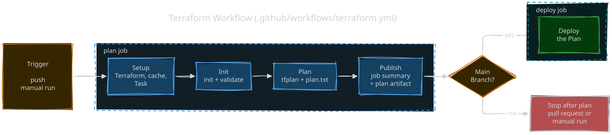

<h1 align="center">Welcome to nikoheikkila.fi 👋</h1>

[](https://github.com/nikoheikkila/nikoheikkila.fi/actions/workflows/ci.yml)

My personal blog. Forked from Gatsby Blog Starter template and inspired here and there by Dan Abramov's blog.

## 🏠 [Live Page](https://nikoheikkila.fi/)

## 🔧 Installation & Usage

Requires [Bun](https://bun.sh) and [Task](https://taskfile.dev). Install dependencies and start the development server like so:

```bash
task install
task dev
```

Then, open <http://localhost:8000> to view the blog.

## 🤖 Run tests

Project is packaged with Biome linter and formatter, Vitest unit and component tests, Stryker mutation tests, and Playwright BDD acceptance tests. Run the full suite like so:

```bash
task test
```

Run a single layer with `task test:unit`, `task test:component`, `task test:mutation`, or `task test:e2e` (requires `task build` first).

## 🚦 Delivery Pipeline

Content and code changes follow the workflow below:


Infrastructure changes with Terraform follow a separate workflow:



## 👤 Author

**Niko Heikkilä &lt;yo@nikoheikkila.fi&gt;**

-   Github: [@nikoheikkila](https://github.com/nikoheikkila)
-   Bluesky: [@nikoheikkila.fi](https://bsky.app/profile/nikoheikkila.fi)
-   LinkedIn: [nikoheikkila](https://www.linkedin.com/in/nikoheikkila)

## 🤝 Contributing

Content can be found under `content/` directory. Edit posts as needed and submit a PR for me to review. Every PR is deployed as a preview version of the `blog-preview` Cloudflare Worker, with the preview link posted as a PR comment. Once approved and merged to the `main` branch, changes are deployed to production.

Other contributions to UI, accessibility, React components, security, dependency updates etc. are warmly welcome as well!

Feel free to check the [open issues](https://github.com/nikoheikkila/nikoheikkila.fi/issues).

## ✍️ Writing

To quickly bootstrap a new post or page draft use the CLI tool via `task new`.

## 📝 License

Copyright of blog posts © 2019–Today [Niko Heikkilä &lt;yo@nikoheikkila.fi&gt;](https://github.com/nikoheikkila).

Source code of this project is [MIT](LICENSE-website) licensed.

---

<small>_This README was generated with ❤️ by [readme-md-generator](https://github.com/kefranabg/readme-md-generator)_.</small>
